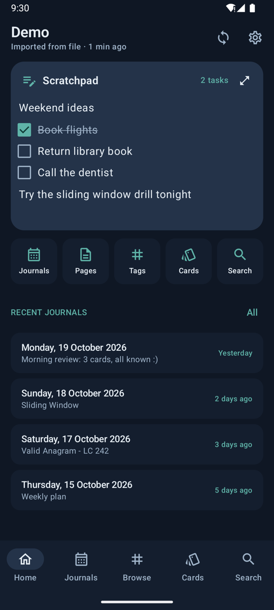
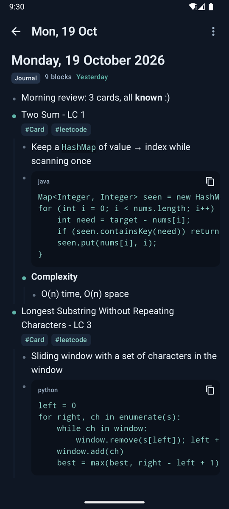
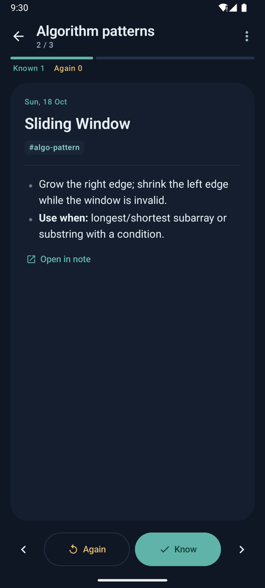
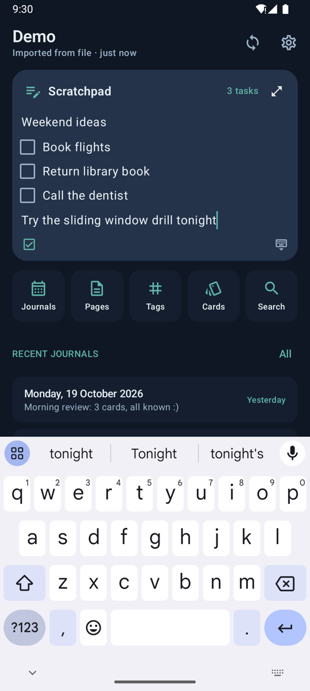
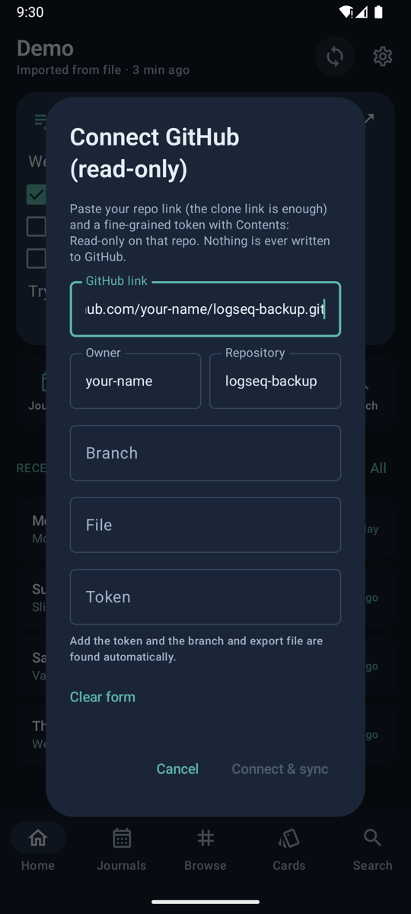
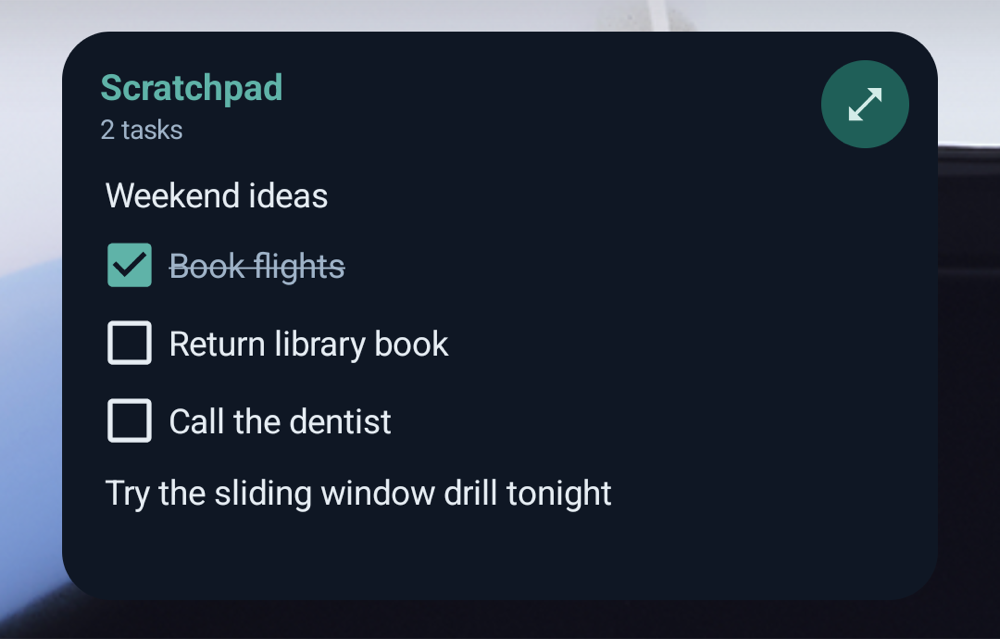

# Logseq Lens

Read your **Logseq** notes on Android: offline, read-only, synced from your own private GitHub backup.
Browse journals and pages, search everything, study your `#Card` flashcards, and jot quick to-dos in a Scratchpad
with a home-screen widget.

> **Unofficial.** Logseq Lens is an independent project and is not affiliated with or endorsed by Logseq.

**[⬇ Download the latest APK](https://github.com/anutej-kardele/logseq-lens/releases/latest)** · Android 8.0+

<p align="center">
  
  
  
  
</p>

## What it does

- **Read** journals and pages with their full nested outline, Markdown, code blocks, `[[links]]` and `#tags`.
- **Search** every note offline.
- **Study** blocks tagged `#Card` as flashcards, grouped by your other tags (for example `#leetcode`).
- **Scratchpad**: one local note for thoughts and checklists, editable on Home and from a home-screen widget.
- **Sync** from your private GitHub repo with a read-only token. Nothing is ever written back.

## Setup

You need a Logseq **DB-version** graph on your computer and a **private** GitHub repo for the export.

### 1. Export your graph to GitHub

Logseq Lens reads a JSON export produced by
**[logseq-backup-tool](https://github.com/anutej-kardele/logseq-backup-tool)**. In short:

1. Create a **private** GitHub repo for your backup, for example `logseq-backup`.
2. Copy the tool's code into it and follow its README to configure your graph.
3. Run it. It exports your graph to `data/mobile/activity.json` and pushes it to your private repo.

Run the tool again whenever you want the app to see new notes.

### 2. Install the app

1. Download `logseq-lens-v1.0.0.apk` from **[Releases](https://github.com/anutej-kardele/logseq-lens/releases/latest)**
   on your phone.
2. Open it and allow **Install unknown apps** when Android asks.
   On Samsung, if **Auto Blocker** stops the install, turn it off temporarily under *Settings → Security and
   privacy → Auto Blocker*.

### 3. Create a read-only GitHub token

1. On GitHub: **Settings → Developer settings → Personal access tokens → Fine-grained tokens → Generate new token**.
2. **Repository access → Only select repositories →** choose your backup repo.
3. **Permissions → Repository permissions → Contents: Read-only.** Leave everything else as is.
4. Generate the token and copy it (it starts with `github_pat_`).

### 4. Connect the app

1. Open **Logseq Lens** and tap the **sync** icon (top right). The **Connect GitHub** form opens.
2. **GitHub link:** paste your backup repo's link. The clone link is enough, for example
   `https://github.com/your-name/logseq-backup.git`.
3. **Token:** paste the token. The branch and the export file (`data/mobile/activity.json`) are filled in
   automatically.
4. Tap **Connect & sync**. Your graph appears and works offline from now on.

<p align="center">
  
</p>

**Try it without GitHub:** download [`docs/demo/demo-graph.json`](docs/demo/demo-graph.json) to your phone and use
**Settings → Import JSON**.

## Everyday use

- **Sync:** tap the sync icon on Home. The line under the graph name shows when it last synced.
- **Switch graphs:** tap the graph name on Home to pick another export in the same folder (for example
  `demo.json`). Switching replaces the notes on the phone; flashcard progress comes back when you switch back.
- **Scratchpad:** tap any line to type. Type `[] ` at the start of a line for a checkbox. Add the widget from the
  Scratchpad's ⋮ menu → *Add widget to home screen*.
- **Flashcards:** *Cards* tab → pick a deck → *Show answer* → *Know* / *Again*. Progress stays on your phone.

<p align="center">
  
</p>

## Privacy

- **Read-only:** the app never edits Logseq and never writes to GitHub. It only downloads your export file.
- Your token is encrypted on the phone with the Android Keystore and never shown again.
- There are no servers, accounts, analytics or trackers. Your notes stay on your phone (excluded from cloud
  backup).

## Build from source

```bash
git clone https://github.com/anutej-kardele/logseq-lens.git
cd logseq-lens
./gradlew assembleDebug
```

Requires the Android SDK and JDK 17+. See [docs/DEVELOPMENT.md](docs/DEVELOPMENT.md) for architecture, release
signing and tests.
